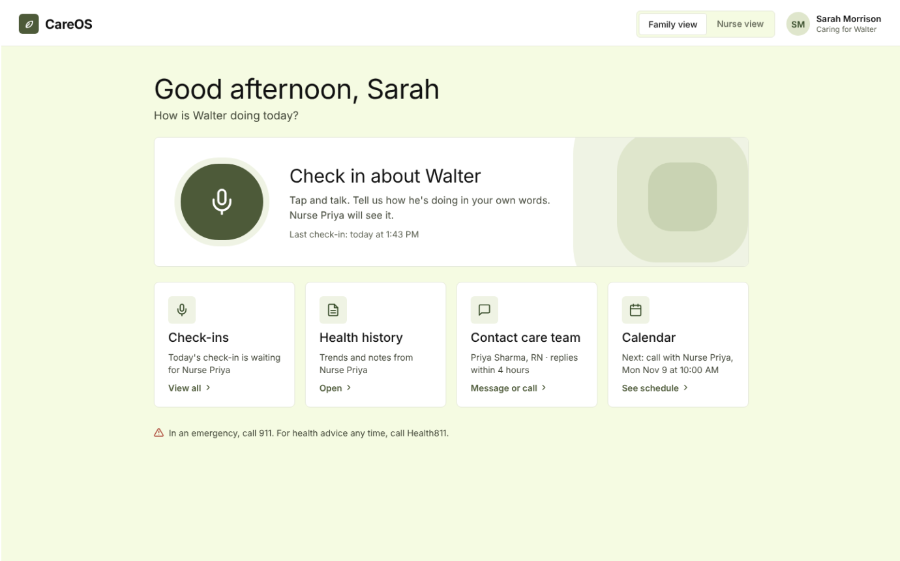
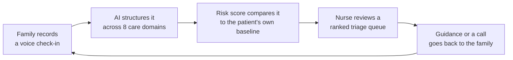
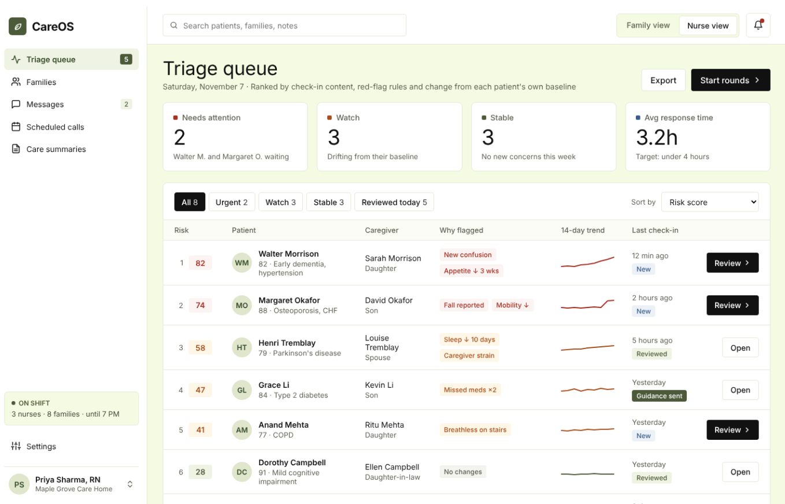
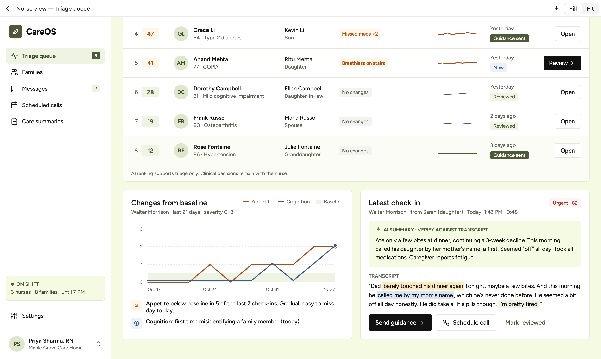

# CareOS

**Professional support for families caring at home.**

Families record a short voice check-in about an aging parent. AI turns it into a structured update, and nurses at a local care home see every family in one explainable triage queue, so they can respond before a slow decline becomes a crisis.

**[Live demo](TODO) · [Demo video](TODO)**

> **Build in progress:** this repo currently holds the product specs and design mockups, and the app is being built from them. Remove this note, and update [What's real in this prototype](#whats-real-in-this-prototype), before submitting.



## The problem

Warning signs in home care rarely arrive as one dramatic event. A parent eats a little less each week, or calls their daughter by the wrong name for the first time. Each moment looks minor on its own, and the person noticing it is an exhausted family member who may not know whether it matters.

Nurses have the expertise to spot the pattern, but they aren't in the home. Forms ask too much of tired caregivers, and a nurse can't phone every family every day.

## The solution

CareOS connects the two sides with one simple loop:



- **For families, one button.** Tap, talk, and get a clear reply. There are no forms or dashboards to learn.
- **For nurses, a ranked queue.** Each patient shows why they were flagged, how they've trended, and the caregiver's own words.
- **For care transitions, a printable summary.** Each item is tagged as nurse-verified or family-reported, ready to hand to a care home.

## Demo: one check-in, start to finish

Walter, 82, has early dementia and lives at home with support from his daughter, Sarah.

1. **Sarah checks in.** She says: *"Dad barely touched his dinner again tonight... this morning he called me by my mom's name, which he's never done before... I'm pretty tired."*
2. **CareOS shows what it heard.** Sarah sees plain-language notes on eating, memory and mood, medications, and how she's doing herself.
3. **Walter reaches the top of the queue.** Nurse Priya sees him at #1 with a risk score of 82, flagged for new confusion and a three-week drop in appetite.
4. **Priya sees the pattern.** The trend chart shows a gradual decline that would be easy to miss day to day. Highlighted quotes tie each finding to the transcript.
5. **Priya responds.** She edits a suggested draft asking Sarah to look for signs of a UTI, then schedules a call.
6. **Sarah gets the reply.** The guidance appears under Check-ins, and the call appears on her calendar.
7. **The record travels.** Priya generates a care summary that can be printed or saved as a PDF.





## What makes it different

**It looks for change, not just bad days.** Each patient is compared against their own recent baseline, so a gradual drift can surface even when no single check-in looks alarming.

**The ranking is explainable.** Risk comes from visible rules rather than an opaque model score, so a nurse can see why someone is ranked where they are:

| Component | Points |
|---|---|
| Red flags | New confusion +25, fall +30, not eating for 2+ days +20, emergency terms +60 |
| Domain severity | Sum of severities across domains × 6 |
| Drift from baseline | +4 per domain above its 14-day baseline |
| Total | Capped at 100 |

**It cares for the caregiver too.** Caregiver strain is tracked as its own domain, so a nurse can notice when the person providing care is struggling.

## Safety by design

- **Nurses make the decisions.** AI ranks and drafts, but a nurse reviews and sends every response.
- **AI output can be checked.** AI-generated content is labeled, and each highlighted quote must match the transcript exactly.
- **Emergencies aren't left in a queue.** Terms like "chest pain" or "not breathing" immediately tell the family to call 911.
- **Sources stay visible.** Care summaries separate what a nurse verified from what a family reported.

## What's real in this prototype

We want judges to know exactly what they're looking at.

| Area | Status |
|---|---|
| Family and nurse screens, including the full response loop | Planned as working features |
| Risk scoring, baselines, and trend insights | Planned as working logic, running on seeded data |
| Microphone recording and live level meter | Planned as working in the browser |
| Transcription and domain extraction | **Simulated:** uses a scripted transcript and keyword rules |
| Patients, families, and nurses | **Fictional:** seeded data with no real patient information |
| Data storage | **Browser only:** `localStorage`, with no backend |
| Call documentation through Vox Advantage | **Mocked** |

CareOS is a hackathon prototype, not a medical device. It should not be used with real patient data or for real clinical decisions.

## Tech stack

- **Frontend:** React, TypeScript, Vite, React Router
- **UI:** Tailwind CSS, shadcn/ui, lucide-react, Recharts
- **State:** Zustand, persisted to `localStorage`
- **Audio:** MediaRecorder and Web Audio APIs

## Getting started

You need Node 20.19 or newer and Docker. From the repo root:

```bash
npm i              # installs everything and generates the Prisma client
npm run db:up      # starts Postgres 16 in Docker on port 5432
npm run db:reset   # drops the local database, applies migrations and seeds demo data
npm run dev        # API on http://localhost:8787/api (and the web app once it exists)
```

No `.env` is needed for local development: the API falls back to the values in `.env.example`. To change them, copy it to `.env`. With `NODE_ENV=production` there are no fallbacks, so `DATABASE_URL` must be set and `DEMO_MODE` defaults to off.

Other commands: `npm test` runs the unit tests, `npm run typecheck` checks types, `npm run smoke` calls every endpoint of a running API, `npm run db:studio` opens Prisma Studio, and `npm run db:deploy` applies migrations to a hosted database.

The app includes demo controls, opened from the gear icon in the bottom-left corner. They can reset the data, simulate a check-in if the mic or wifi fails, trigger the emergency flow, and jump between screens.

## What's next

- **Real AI pipeline:** speech-to-text, then Claude with a strict JSON schema to extract the domains. Risk scoring stays rule-based so the ranking remains explainable.
- **Backend:** a server and a Postgres database to replace browser storage, with accounts and access controls for each care home.
- **Clinical validation:** work with nurses to test and tune the scoring rules before any real-world use.
- **Privacy and compliance:** a review of health privacy requirements before handling real patient data.

## Team

TODO: names and roles
