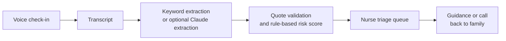

# CareOS

**Professional support for families caring at home.**

Families record short voice check-ins about an aging parent. CareOS structures what was said, applies transparent rule-based risk scoring, and gives nurses a ranked queue for review and response.

**[Live demo](TODO) · [Demo video](TODO)**


## How it works



In the default simulated mode, deterministic keyword rules structure check-ins. With `AI_MODE=live`, an optional Whisper-compatible speech-to-text provider transcribes recordings and Claude extracts the eight domains, an AI summary, and caregiver questions. The server validates the result and accepts a quote only when it appears exactly in the transcript. A missing or invalid quote clears that domain's severity.

The risk score is always computed by `packages/shared/risk.ts`, never by the LLM. It combines fixed points for red flags with domain severity and changes from the patient's own 14-day baseline. Scores are capped at 100. Emergency keywords are checked independently and always trigger the call-911 warning.

Every response is reviewed and sent by a nurse. AI-generated summaries are labelled "AI summary · verify against transcript"; care summaries distinguish nurse-verified information from family reports.

## What's real

| Area | Implementation |
|---|---|
| API, Postgres database, migrations and seed | Working |
| Nurse triage and family check-in flows | Working prototype |
| Domain extraction and risk score | Deterministic simulated extraction by default; risk is always rule-based |
| Speech transcription and Claude extraction | Optional server-side providers; credentials are not sent to the browser |
| Demo reset and simulated check-ins | Available when `DEMO_MODE=true` |
| Patients, caregivers, nurses and check-in history | Synthetic demo data only |
| Hosting | Deployment instructions below; hosting is not configured by this repository |

Hackathon prototype, not a medical device. Risk scores are for nurse triage support and are not diagnoses or clinical recommendations. A real launch needs clinical validation, PHIPA compliance, Canadian data residency, consent flows (including substitute decision-makers), and audit logging.

## Getting started

Needs Node 20.19+ and Docker.

```bash
npm install
npm run db:up      # Postgres 16 on 5432
npm run db:reset   # migrate and seed local synthetic data
npm run dev        # API on :8787, web on :5173
```

No `.env` is needed for local simulated mode. To use live AI, set server-only values in `.env`:

```dotenv
AI_MODE=live
ANTHROPIC_API_KEY=...
STT_PROVIDER=whisper
STT_API_KEY=...
```

The `STT_API_URL` and `STT_MODEL` variables select the Whisper-compatible endpoint and model. `ANTHROPIC_MODEL` defaults to `claude-sonnet-5-5`. Never use a `VITE_` variable for a secret.

Useful commands: `npm test`, `npm run typecheck`, `npm run smoke`, `npm run build`, and `npm run db:studio`.

**Stack:** Hono, Prisma, PostgreSQL, zod, Anthropic TypeScript SDK · React, Vite, Tailwind, shadcn/ui, TanStack Query, Recharts.

## Deploying

The app is a prototype; these are deployment steps, not a configured production service.

1. **Provision Postgres** on a managed service and set `DATABASE_URL` on the API. Apply migrations with `npm run db:deploy`, then load synthetic demo records with `npm run db:seed`. Do not run `db:reset` or `prisma migrate dev` against a hosted database.
2. **Deploy the API** from the repository root with Node 20.19+. The API build script runs `prisma generate` before TypeScript validation: `npm run build -w @careos/api`. Start it with `npm run start -w @careos/api`. Configure `DATABASE_URL`, `WEB_ORIGIN`, `DEMO_MODE=true`, and `UPLOAD_DIR`. Set `TRUST_PROXY=true` only when requests arrive through a proxy you control. `UPLOAD_DIR` must be on persistent storage for recordings to survive restarts; without a persistent volume, add an S3-compatible storage adapter before deploying.
3. **Configure live AI only if needed.** Set `AI_MODE=live`, `ANTHROPIC_API_KEY`, and the STT provider credentials on the API service. Keep all keys out of web build variables. Without working provider credentials, check-ins use the simulated pipeline.
4. **Deploy the web app** to Vercel, Netlify, or another static host. Build with `npm run build -w @careos/web` and set `VITE_API_URL` to the API's origin (for example `https://api.example.ca`, without `/api`). Set the API's `WEB_ORIGIN` to the deployed web origin so CORS allows it.
5. Keep `DEMO_MODE=true` only for a synthetic-data demo. It exposes the guarded reset and demo actions; do not use those with real records.

**Privacy:** the demo uses synthetic data only. A real launch requires PHIPA compliance, Canadian data residency, consent flows (including substitute decision-makers), audit logging, and appropriate security and clinical review.

## Team

TODO: names and roles
