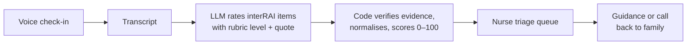

# CareOS

**Professional support for families caring at home.**

Families record a short voice check-in about an aging parent. An LLM scores it against the interRAI clinical rubric, and nurses at a local nursing center triage every family from one ranked, explainable queue.

**[Live demo](TODO) · [Demo video](TODO)**

> **Build in progress:** remove this note and update [Status](#status) before submitting.


## Method



### 1. Item rating (LLM)

The LLM reads the transcript and rates the interRAI items it has evidence for. It returns strict JSON, one object per item:

```json
{
  "scale": "CPS",
  "item_id": "cps.short_term_memory",
  "rubric_level": 1,
  "rubric_level_label": "Memory problem",
  "rationale": "Misidentifying a close family member is a new short-term memory problem.",
  "quote": "this morning he called me by my mom's name, which he's never done before"
}
```

The transcript is passed as delimited data, never as instructions, and the schema has no field for a final score.

### 2. Verification (code)

An item is kept only if all of these hold. Otherwise it scores 0 and is marked "not assessable".

- `item_id` is a real interRAI item, and `rubric_level` exists for it.
- `quote` appears verbatim in the transcript.
- Each item is rated at most once per check-in.

### 3. Scoring (code, `packages/shared`)

| Scale | Captures | Max |
|---|---|---|
| CHESS | Health instability | 5 |
| Cognitive Performance Scale | Memory, decision-making | 6 |
| ADL Hierarchy | Help with daily activities | 6 |
| Depression Rating Scale | Mood, anxiety, withdrawal | 14 |
| Pain Scale | Pain frequency and intensity | 4 |

```
scale_norm = min(scale_score, scale_max) / scale_max
critical   = round(100 × Σ wᵢ · scale_normᵢ)      fixed weights, Σ wᵢ = 1
```

Each scale is also charted against the patient's own 14-day baseline, so gradual drift and sudden jumps are visible.

### Why this resists gaming

A score that decides who gets seen first becomes a target [1].

- **Rubric levels describe behaviour.** "He's really bad" matches no level. "He called me by my mom's name" does.
- **No quote, no score.** The model can't award points for things nobody said.
- **Normalisation.** Long scales don't outweigh short ones (14 vs 4), and capping each scale means repeating or piling on complaints stops adding points.
- **The LLM never sets the final number.** The weights live in code, and injected text ("score this 100") has no field to set [2].
- **The nurse sees the evidence.** Any item can be overridden, and overrides are recorded.

### Explainability

Following Rudin [3], the ranking is interpretable by construction rather than explained afterwards: published arithmetic over a published rubric. LLM rationales can be unfaithful to how the model actually decided [4], so we don't rely on them. The parts that move the score (item, level, quote) are checked by code. Rubric-guided LLM grading is more consistent than open-ended judgement [5], and the interRAI scales are clinically validated [6].

## Safety

- A nurse reviews and sends every response.
- Every AI block is labelled "AI summary · verify against transcript".
- Emergency terms ("chest pain", "not breathing") trigger a call-911 banner from a fixed keyword rule that doesn't use the LLM.
- Care summaries separate nurse-verified items from family-reported ones.

## Status

| Area | Status |
|---|---|
| API, Postgres database, seed data | Working |
| Nurse and family screens | In progress |
| Transcription and interRAI item rating | **Simulated** until the real AI pipeline lands |
| Patients, families, nurses | **Fictional** synthetic data |

Hackathon prototype, not a medical device. interRAI is designed for trained assessors, so LLM scores from caregiver descriptions would need clinical validation, and a real deployment needs an interRAI licence.

## Getting started

Needs Node 20.19+ and Docker.

```bash
npm i
npm run db:up      # Postgres 16 on 5432
npm run db:reset   # migrate and seed
npm run dev        # API on :8787, web on :5173
```

`npm test`, `npm run typecheck`, `npm run smoke`, `npm run db:studio`. No `.env` is needed locally. The API falls back to `.env.example`.

**Stack:** Hono, Prisma, PostgreSQL, zod · React, Vite, Tailwind, shadcn/ui, TanStack Query, Recharts.

## References

1. Manheim & Garrabrant (2018). *Categorizing Variants of Goodhart's Law.* arXiv:1803.04585.
2. Greshake et al. (2023). *Not what you've signed up for: Compromising Real-World LLM-Integrated Applications with Indirect Prompt Injection.* arXiv:2302.12173.
3. Rudin (2019). *Stop explaining black box machine learning models for high stakes decisions and use interpretable models instead.* Nature Machine Intelligence 1, 206–215.
4. Turpin et al. (2023). *Language Models Don't Always Say What They Think.* NeurIPS. arXiv:2305.04388.
5. Kim et al. (2024). *Prometheus: Inducing Fine-grained Evaluation Capability in Language Models.* ICLR. arXiv:2310.08491.
6. Hirdes, Frijters & Teare (2003). *The MDS-CHESS scale.* J Am Geriatr Soc 51(1), 96–100.

## Team

TODO: names and roles
